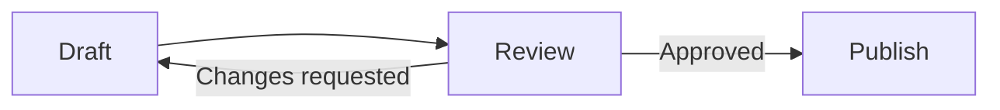
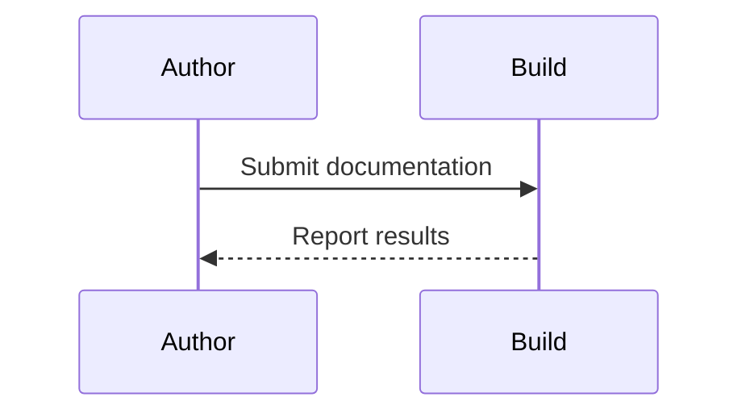

# Diagrams


These diagrams describe a documentation review and the exchange between an author and a build service.





??? abstract "Show Markdown source"

    ``````markdown
    ```mermaid
    flowchart LR
        Draft --> Review
        Review -->|Approved| Publish
        Review -->|Changes requested| Draft
    ```
    
    ```mermaid
    sequenceDiagram
        participant Author
        participant Build
        Author->>Build: Submit documentation
        Build-->>Author: Report results
    ```
    ``````


## References

- [Diagrams](https://zensical.org/docs/authoring/diagrams/)
- [Mathematics](https://zensical.org/docs/authoring/math/)
- [Images](https://zensical.org/docs/authoring/images/)
- [Icons and emojis](https://zensical.org/docs/authoring/icons-emojis/)
