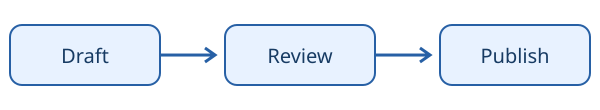

# Images


This local SVG provides an accessible, self-contained illustration.

<figure markdown="span">
  { width="600" }
  <figcaption>A small documentation workflow, from draft to publication.</figcaption>
</figure>

??? abstract "Show Markdown source"

    ``````markdown
    <figure markdown="span">
      { width="600" }
      <figcaption>A small documentation workflow, from draft to publication.</figcaption>
    </figure>
    ``````


## Lazy loading and palette variants

The same local illustration is used for both palettes here. Swap in different files when your artwork needs distinct contrast.

{ loading=lazy width="400" }
{ loading=lazy width="400" }

??? abstract "Show Markdown source"

    ``````markdown
    { loading=lazy width="400" }
    { loading=lazy width="400" }
    ``````

## Alignment

A small image can sit beside text. On narrow screens it may use the available width instead.

{ align=right width="240" }

A draft passes through review before publication. The illustration reinforces the sequence while leaving the prose readable.

??? abstract "Show Markdown source"

    ``````markdown
    { align=right width="240" }
    
    A draft passes through review before publication. The illustration reinforces the sequence while leaving the prose readable.
    ``````

## References

- [Diagrams](https://zensical.org/docs/authoring/diagrams/)
- [Mathematics](https://zensical.org/docs/authoring/math/)
- [Images](https://zensical.org/docs/authoring/images/)
- [Icons and emojis](https://zensical.org/docs/authoring/icons-emojis/)

## Caption extension

A caption can follow an image without HTML. This uses `pymdownx.blocks.caption`.

{ width="400" }
/// caption
Draft, review, and publish.
///

??? abstract "Show Markdown source"

    ```markdown
    { width="400" }
    /// caption
    Draft, review, and publish.
    ///
    ```
