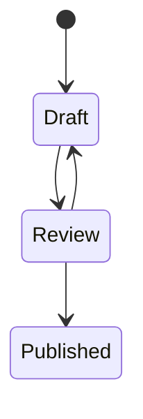
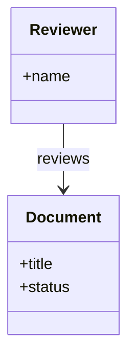
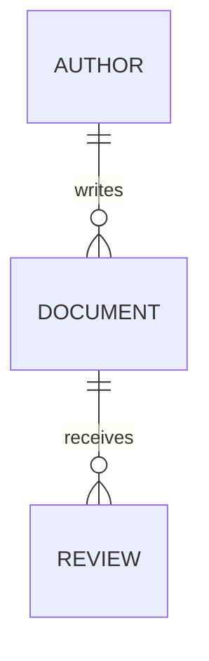

# Diagram models


State, class, and entity relationships expose different aspects of the same workflow.







??? abstract "Show Markdown source"

    ``````markdown
    ```mermaid
    stateDiagram-v2
        [*] --> Draft
        Draft --> Review
        Review --> Published
        Review --> Draft
    ```
    
    ```mermaid
    classDiagram
        class Document {
          +title
          +status
        }
        class Reviewer {
          +name
        }
        Reviewer --> Document : reviews
    ```
    
    ```mermaid
    erDiagram
        AUTHOR ||--o{ DOCUMENT : writes
        DOCUMENT ||--o{ REVIEW : receives
    ```
    ``````


## References

- [Diagrams](https://zensical.org/docs/authoring/diagrams/)
- [Mathematics](https://zensical.org/docs/authoring/math/)
- [Images](https://zensical.org/docs/authoring/images/)
- [Icons and emojis](https://zensical.org/docs/authoring/icons-emojis/)
