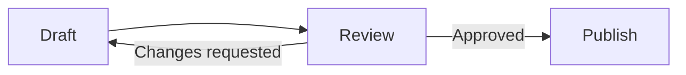
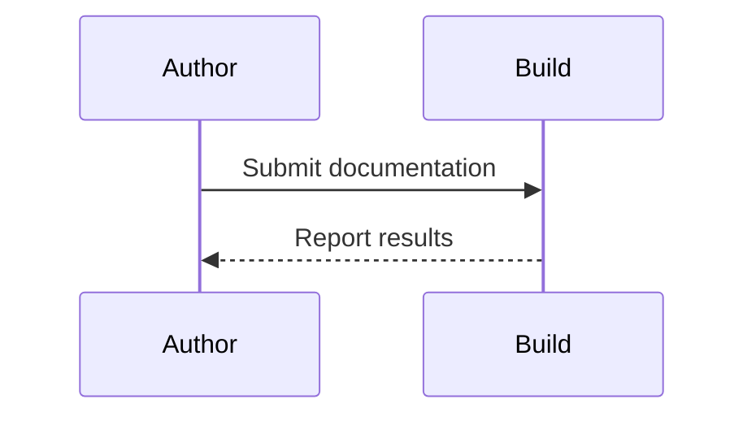
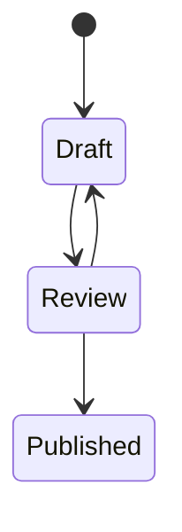
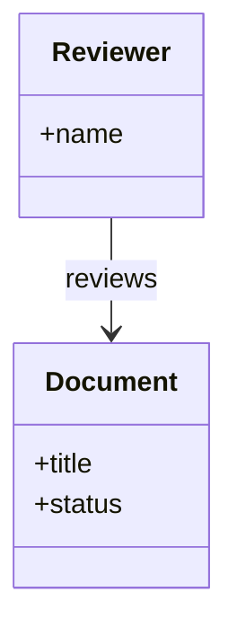
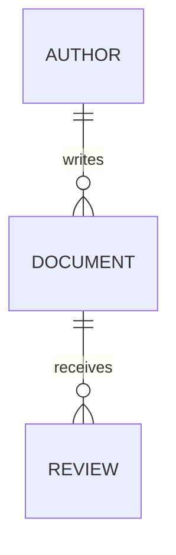
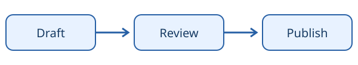

# Visual explanations

Use diagrams, math, and images when the shape of an idea carries meaning that prose alone would hide.

## Flow and sequence

These diagrams describe a documentation review and the exchange between an author and a build service.





??? abstract "Show Markdown source"

    ``````markdown
    ```mermaid
    flowchart LR
        Draft --> Review
        Review -->|Approved| Publish
        Review -->|Changes requested| Draft
    ```
    
    ```mermaid
    sequenceDiagram
        participant Author
        participant Build
        Author->>Build: Submit documentation
        Build-->>Author: Report results
    ```
    ``````

## Models and state

State, class, and entity relationships expose different aspects of the same workflow.







??? abstract "Show Markdown source"

    ``````markdown
    ```mermaid
    stateDiagram-v2
        [*] --> Draft
        Draft --> Review
        Review --> Published
        Review --> Draft
    ```
    
    ```mermaid
    classDiagram
        class Document {
          +title
          +status
        }
        class Reviewer {
          +name
        }
        Reviewer --> Document : reviews
    ```
    
    ```mermaid
    erDiagram
        AUTHOR ||--o{ DOCUMENT : writes
        DOCUMENT ||--o{ REVIEW : receives
    ```
    ``````

## Mathematics

Inline notation keeps a variable in context; display notation gives a derivation room to breathe.

A sample mean is written as $\bar{x}$, where $n$ is the number of observations.

$$
\bar{x} = \frac{1}{n} \sum_{i=1}^{n} x_i
$$

For a right triangle, $a^2 + b^2 = c^2$.

??? abstract "Show Markdown source"

    ``````markdown
    A sample mean is written as $\bar{x}$, where $n$ is the number of observations.
    
    $$
    \bar{x} = \frac{1}{n} \sum_{i=1}^{n} x_i
    $$
    
    For a right triangle, $a^2 + b^2 = c^2$.
    ``````

## Images and captions

This local SVG provides an accessible, self-contained illustration.

<figure markdown="span">
  { width="600" }
  <figcaption>A small documentation workflow, from draft to publication.</figcaption>
</figure>

??? abstract "Show Markdown source"

    ``````markdown
    <figure markdown="span">
      { width="600" }
      <figcaption>A small documentation workflow, from draft to publication.</figcaption>
    </figure>
    ``````

## Icons and emoji

Icons can signal intent; adjacent text carries the meaning.

:material-check-circle: **Ready** — the example has been reviewed.

:material-information-outline:{ title="More information" } Hover for a short explanation.

:rocket: The release is ready to launch.

??? abstract "Show Markdown source"

    ``````markdown
    :material-check-circle: **Ready** — the example has been reviewed.
    
    :material-information-outline:{ title="More information" } Hover for a short explanation.
    
    :rocket: The release is ready to launch.
    ``````

## References

- [Diagrams](https://zensical.org/docs/authoring/diagrams/)
- [Mathematics](https://zensical.org/docs/authoring/math/)
- [Images](https://zensical.org/docs/authoring/images/)
- [Icons and emojis](https://zensical.org/docs/authoring/icons-emojis/)
