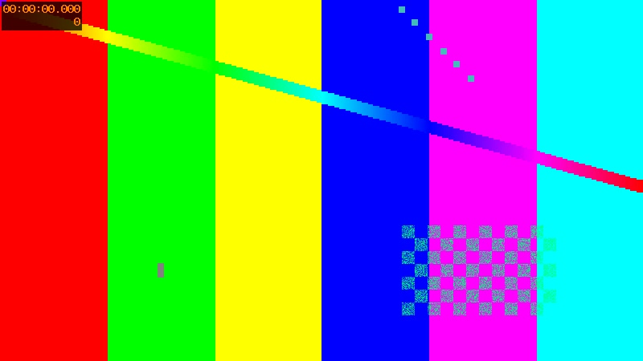

# optimize

Optimize local PNG and JPEG images during builds. Native support was added in Zensical **0.0.74**.

Shrink a screenshot-heavy guide; optimize photos without changing their URLs.

## Try it

[Open the optimize example](/zensical-examples/variants/optimize/).

### JPEG optimization

Compare `photo.jpg` in the source and built site: the build reduces its size.

### Stable URL

The image remains available under the same `photo.jpg` path after optimization.

## Measured result

The fixture is 35,782 bytes before the build and 18,314 bytes after optimization, a reduction of 17,468 bytes (about 49%). JPEG compression is lossy, so the optimized image may differ visually.

| Original | Built image |
| --- | --- |
|  |  |
| [35,782-byte source](../assets/plugins/optimize-original.jpg) | [18,314-byte output](/zensical-examples/variants/optimize/photo.jpg) |

??? example "Source and configuration"

    The [configuration](https://github.com/pete-wai/zensical-examples/blob/main/variants/plugins/optimize/zensical.toml) and [example Markdown](https://github.com/pete-wai/zensical-examples/blob/main/variants/plugins/optimize/docs/index.md) are available in the repository. Other files in that directory supply the example’s fixtures.

[Zensical compatibility and settings](https://zensical.org/docs/compatibility/mkdocs/plugins/#optimize) · [Plugin documentation](https://squidfunk.github.io/mkdocs-material/plugins/optimize/)
