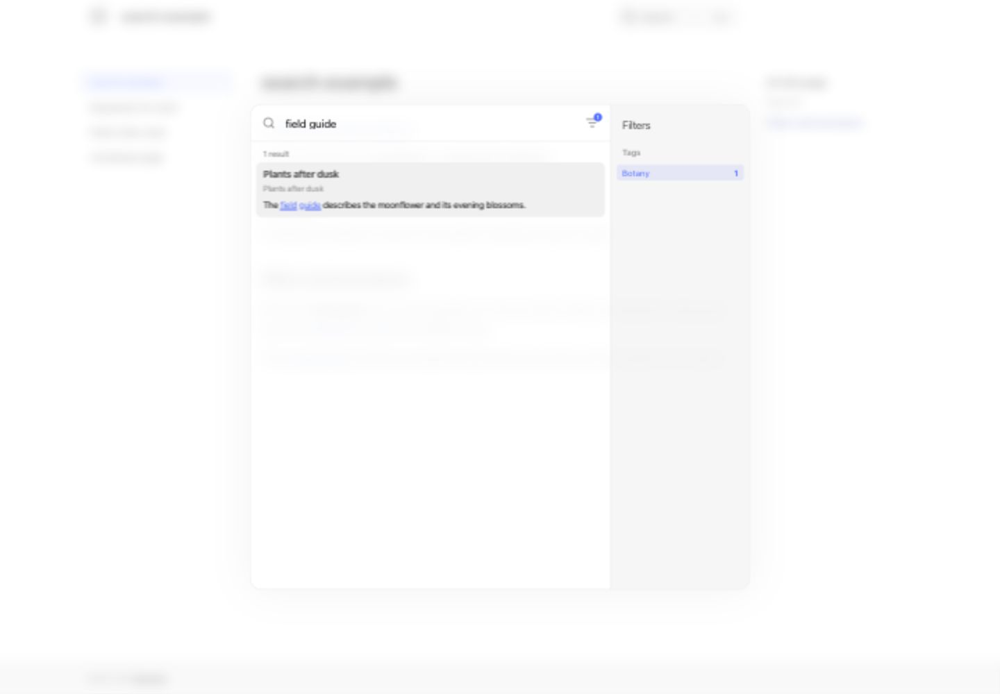

# search

Provide full-text search for documentation. Native support was added in Zensical **0.0.3**.

Find an obscure term across a handbook; jump from a search result directly to a section.

## Try it

[Open the search example](/zensical-examples/variants/search/).

### Exact term

Search for “moonflower” to find the distinctive term in the page.

### Phrase

Search for “waterproof notebook” to locate the field-kit section.

### Tag filters

Search for “field guide” and use the tag filter to narrow the results to **Botany** or **Equipment**. The two tagged pages have matching text and different tags, so the filter changes which result remains.

### Excluded page

The [unindexed page](/zensical-examples/variants/search/unindexed/) contains the distinctive word `quartzbeacon`. Try searching for it in the example: the page remains readable at its URL, but its `search.exclude: true` front matter keeps it out of the index. Exclusion affects search, not access to the page.

??? example "Source and configuration"

    The [configuration](https://github.com/pete-wai/zensical-examples/blob/main/variants/plugins/search/zensical.toml) and [example Markdown](https://github.com/pete-wai/zensical-examples/blob/main/variants/plugins/search/docs/index.md) are available in the repository. Other files in that directory supply the example’s fixtures.

[Zensical compatibility and settings](https://zensical.org/docs/compatibility/mkdocs/plugins/#search) · [Plugin documentation](https://zensical.org/docs/setup/search/)

## Filtered results

{ loading=lazy }

This capture shows the query `field guide` narrowed to the Botany tag in UI 0.0.41. The Equipment page no longer appears.
