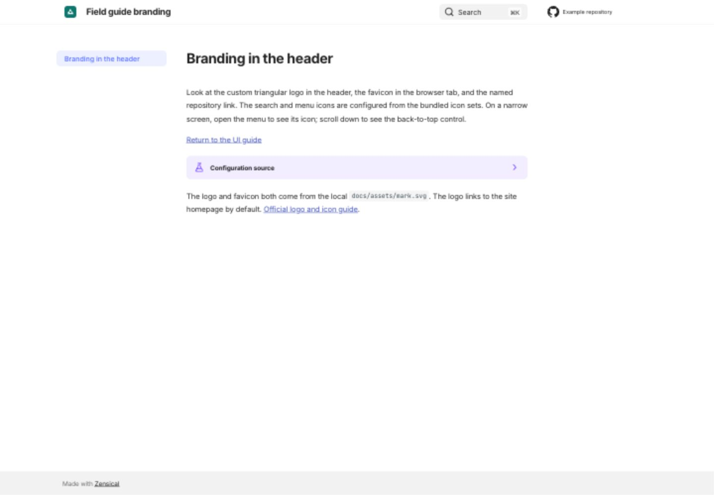

# Logo, favicon, and icons

[Open the branding demonstration](/zensical-examples/variants/branding/){ .md-button .md-button--primary }

The demonstration uses the same local SVG as its header logo and browser favicon. Its header also names a repository and changes the repository, search, menu, and back-to-top icons. The menu is visible on a narrow screen; the back-to-top control appears after scrolling.

??? example "Show configuration"

    ```toml
    [project]
    repo_url = "https://github.com/pete-wai/zensical-examples"
    repo_name = "Example repository"

    [project.theme]
    logo = "assets/mark.svg"
    favicon = "assets/mark.svg"
    features = ["navigation.top"]

    [project.theme.icon]
    repo = "fontawesome/brands/github"
    search = "lucide/search"
    menu = "lucide/menu"
    top = "lucide/arrow-up"
    ```

The image paths are relative to the variant's `docs` directory. Alternatively, `theme.icon.logo` selects a bundled icon. The logo normally links to the site's homepage; `project.extra.homepage` can change its destination. See the [official logo and icons guide](https://zensical.org/docs/setup/logo-and-icons/) and [repository setup](https://zensical.org/docs/setup/repository/).

## Desktop preview

{ loading=lazy }
