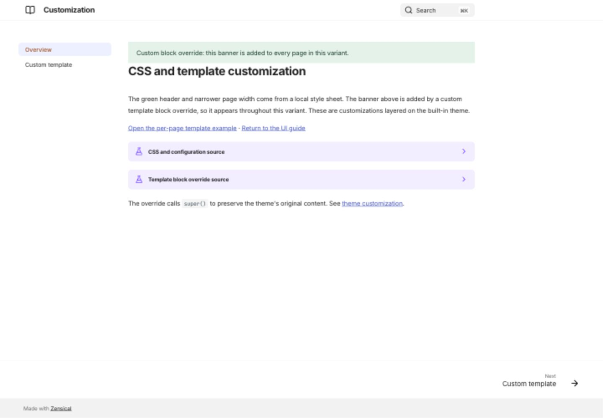

# CSS and template customization

[Open the customization demonstration](/zensical-examples/variants/customization/){ .md-button .md-button--primary }

The demonstration extends the built-in theme with a local CSS file and MiniJinja templates. It is a customization example: the colored banners are supplied by the variant, not built-in theme controls.

## CSS colors and width

The variant applies a green primary color, a warm accent, and a 68-rem maximum grid width. Compare it with the main site to see the difference.

??? example "Show CSS and configuration"

    ```toml
    [project]
    extra_css = ["assets/extra.css"]

    [project.theme]
    custom_dir = "overrides"
    ```

    ```css
    :root > * {
      --md-primary-fg-color: #315d51;
      --md-accent-fg-color: #a04f24;
    }
    .md-grid { max-width: 68rem; }
    ```

## Override a block

The green banner appears on both pages in the variant because its `overrides/main.html` extends the base template and adds content to a block. `super()` preserves the original block.

??? example "Show override"

    ```jinja
    
    
      <div class="customization-banner">Custom block override: this banner is added to every page in this variant.</div>
      {{ super() }}
    
    ```

## Select a page template

The [per-page template example](/zensical-examples/variants/customization/template/) adds an orange note only on that page. Its front matter selects `example.html`, which extends the shared override. See the complete source in the demo and the [official customization guide](https://zensical.org/docs/customization/).

??? example "Show page-specific template"

    ```yaml
    ---
    template: example.html
    ---
    ```

    ```jinja
    
    
      <div class="custom-template-note">Custom per-page template: this note is added only to the template example.</div>
      {{ super() }}
    
    ```

## Desktop preview

{ loading=lazy }
