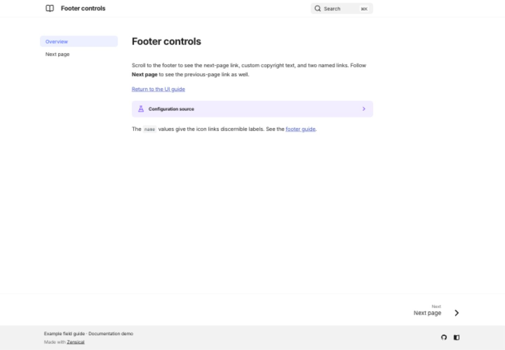

# Footer and social links

[Open the footer demonstration](/zensical-examples/variants/footer/){ .md-button .md-button--primary }

The variant's footer combines a copyright notice, two named icon links, and previous/next page navigation. Open its second page to see the previous link. These controls are built into the theme; the source below shows their configuration.

??? example "Show configuration"

    ```toml
    [project]
    copyright = "Example field guide · Documentation demo"
    nav = [{"Overview"="index.md"}, {"Next page"="next.md"}]

    [project.theme]
    features = ["navigation.footer"]

    [project.theme.icon]
    previous = "fontawesome/solid/angle-left"
    next = "fontawesome/solid/angle-right"

    [[project.extra.social]]
    icon = "fontawesome/brands/github"
    link = "https://github.com/pete-wai/zensical-examples"
    name = "Example repository on GitHub"

    [[project.extra.social]]
    icon = "fontawesome/solid/book-open"
    link = "https://zensical.org/docs/"
    name = "Zensical documentation"
    ```

Use `name` to give an icon link a meaningful title. A page can hide its previous/next links with `hide: [footer]` in front matter. See the [official footer guide](https://zensical.org/docs/setup/footer/).

## Desktop preview

{ loading=lazy }
