# UI & configuration

Change one aspect of the interface and compare the result. These are independent native Zensical builds, all using the same field-guide content. Page-level options are demonstrated separately.

[Branding](branding.md) · [Footer](footer.md) · [Customization](customization.md) · [Build behavior](build-workflow.md)

[Page-level layout](page-layout.md) · [Site behavior](site-behavior.md) · [External services](external-services.md)

## Plain navigation

The sidebar uses collapsible groups. Open Guides, then return here to compare the expanded version.

[Open live plain navigation demo](/zensical-examples/variants/baseline/){ .md-button }

??? example "Screenshot: Plain navigation"

    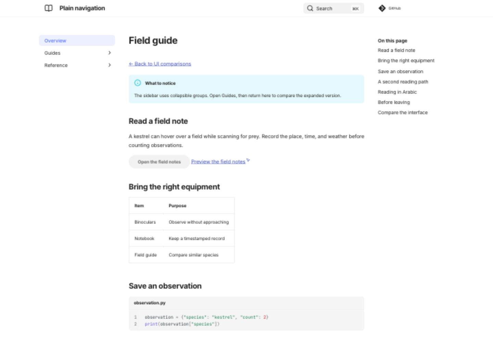{ loading=lazy }

??? example "Settings used in this comparison"

    ```toml
    features = []
    ```

## Classic theme

Compare the header, typography, spacing, and code blocks with the modern baseline. The content is identical.

[Open live classic theme demo](/zensical-examples/variants/classic/){ .md-button }

??? example "Screenshot: Classic theme"

    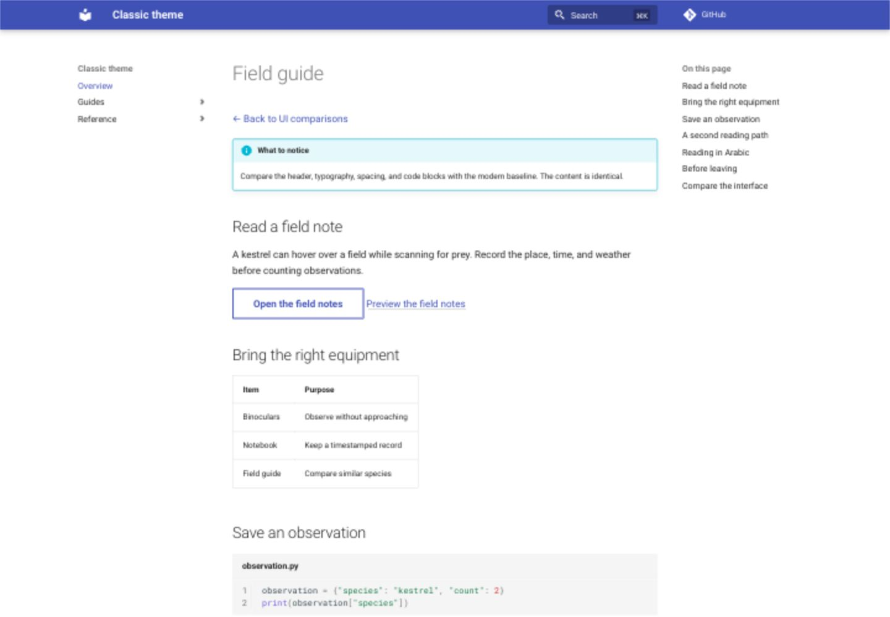{ loading=lazy }

??? example "Settings used in this comparison"

    ```toml
    features = []
    variant = "classic"
    ```

## Navigation tabs

Top-level sections become tabs. Scroll down: the tab bar stays visible. On a narrow screen, use the menu instead.

[Open live navigation tabs demo](/zensical-examples/variants/tabs/){ .md-button }

??? example "Screenshot: Navigation tabs"

    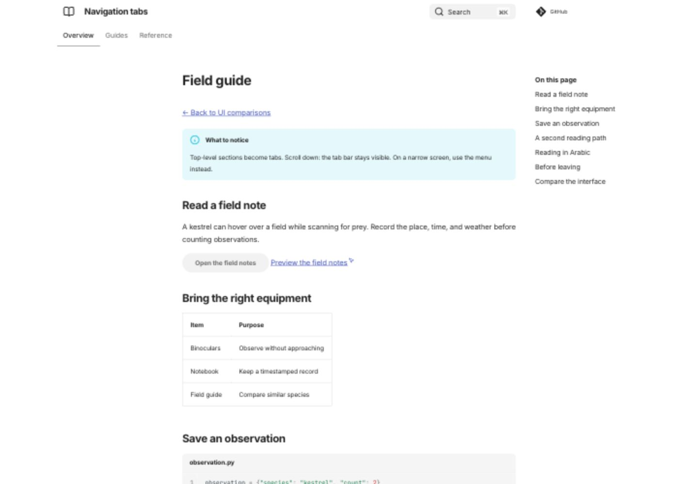{ loading=lazy }

??? example "Settings used in this comparison"

    ```toml
    features = ["navigation.tabs", "navigation.tabs.sticky"]
    ```

## Navigation sections

Top-level groups are visible section labels instead of collapsed containers. Compare this with Plain navigation.

[Open live navigation sections demo](/zensical-examples/variants/sections/){ .md-button }

??? example "Screenshot: Navigation sections"

    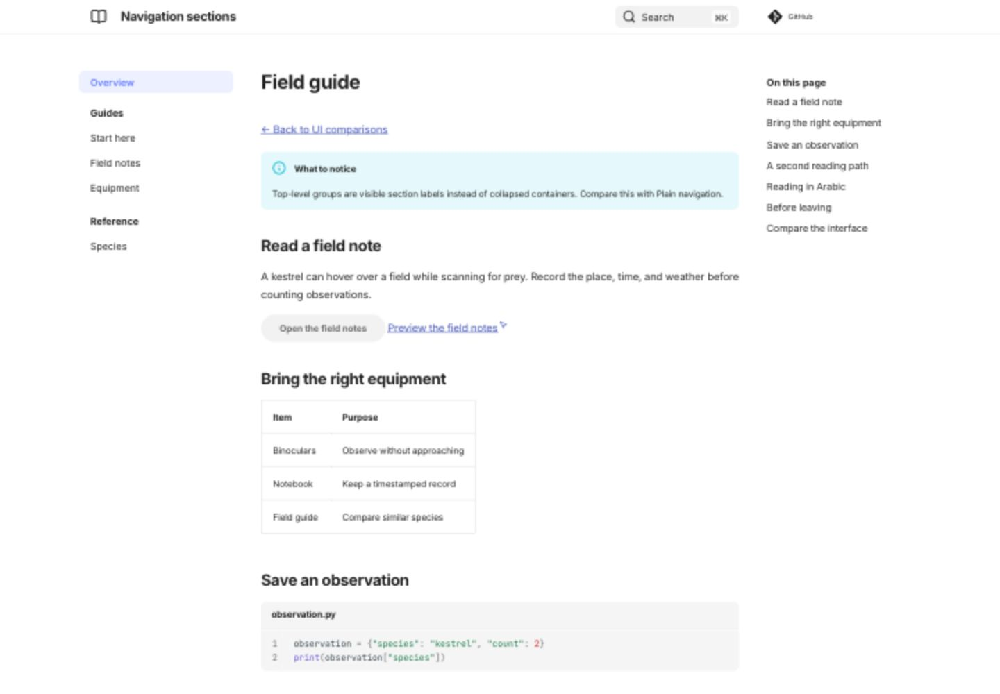{ loading=lazy }

??? example "Settings used in this comparison"

    ```toml
    features = ["navigation.sections"]
    ```

## Expanded navigation

All navigation groups start expanded. This suits short manuals but gets noisy on large sites.

[Open live expanded navigation demo](/zensical-examples/variants/expanded/){ .md-button }

??? example "Screenshot: Expanded navigation"

    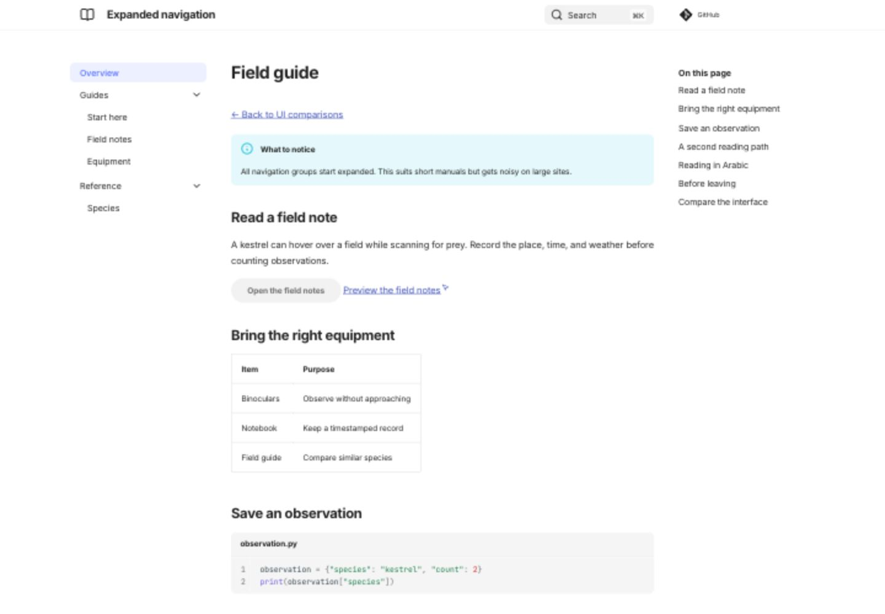{ loading=lazy }

??? example "Settings used in this comparison"

    ```toml
    features = ["navigation.expand"]
    ```

## Pruned navigation

Only the current branch is expanded in the generated navigation. Enter Guides to see its children. This reduces large navigation trees.

[Open live pruned navigation demo](/zensical-examples/variants/pruned/){ .md-button }

??? example "Screenshot: Pruned navigation"

    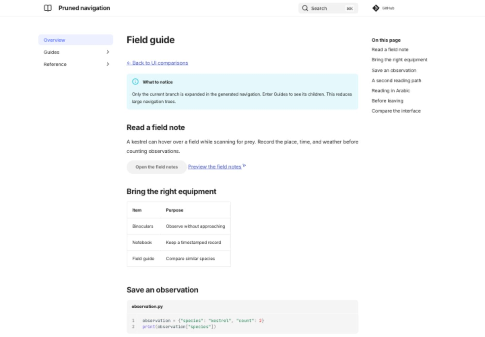{ loading=lazy }

??? example "Settings used in this comparison"

    ```toml
    features = ["navigation.prune", "navigation.indexes"]
    ```

## Breadcrumbs and section indexes

Open Guides → Field notes. Breadcrumbs expose the hierarchy and the footer moves through the reading sequence.

[Open live breadcrumbs and section indexes demo](/zensical-examples/variants/breadcrumbs/){ .md-button }

??? example "Screenshot: Breadcrumbs and section indexes"

    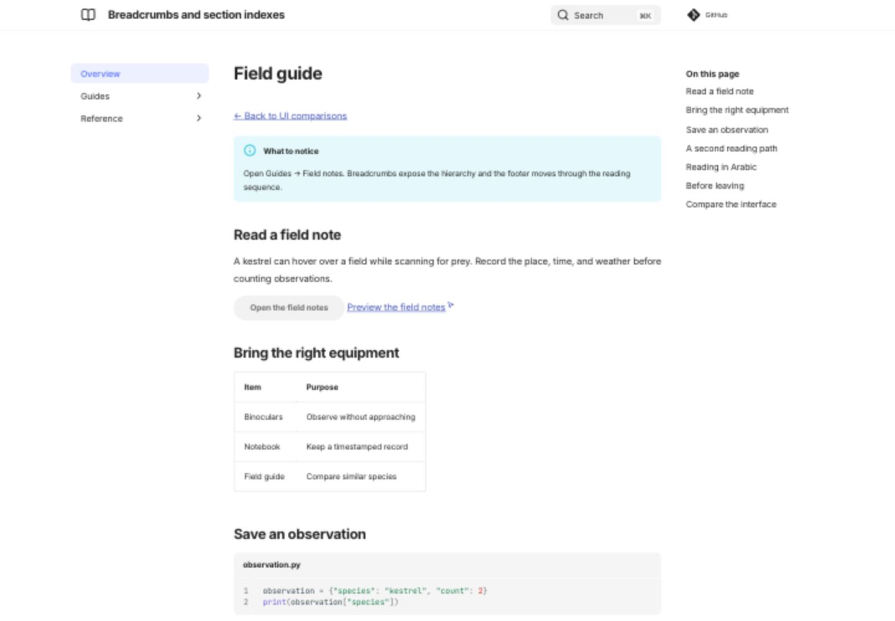{ loading=lazy }

??? example "Settings used in this comparison"

    ```toml
    features = ["navigation.path", "navigation.indexes", "navigation.footer"]
    ```

## Table of contents in navigation

The current page headings appear in the left navigation. Scroll through the page to follow the active section.

[Open live table of contents in navigation demo](/zensical-examples/variants/integrated-toc/){ .md-button }

??? example "Screenshot: Table of contents in navigation"

    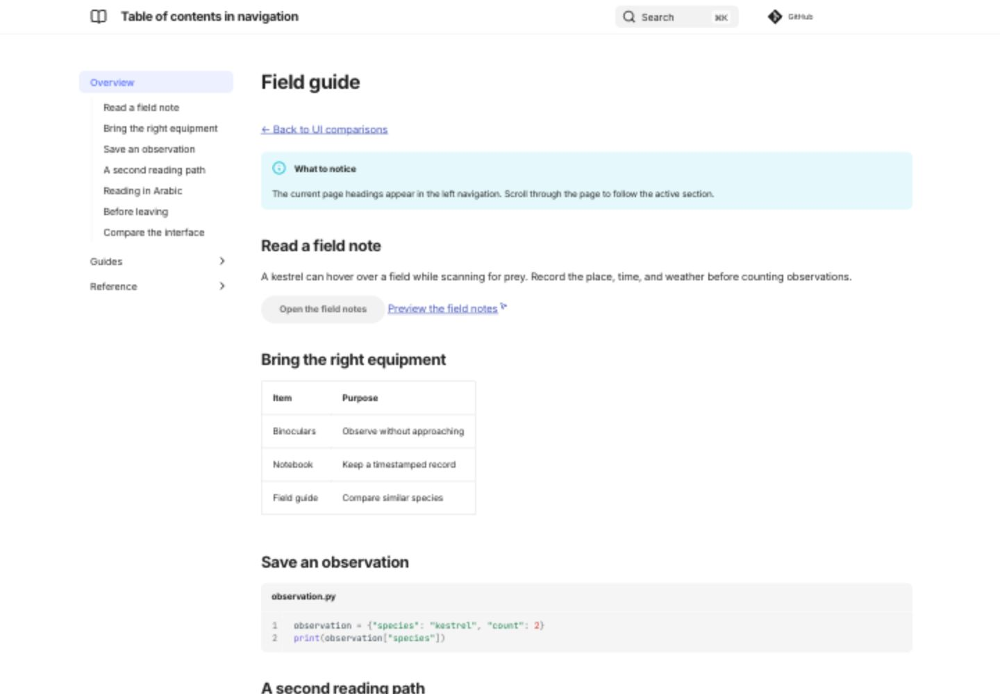{ loading=lazy }

??? example "Settings used in this comparison"

    ```toml
    features = ["toc.integrate", "toc.follow"]
    ```

## Instant navigation and previews

Follow an internal link without a full page reload. Hover the preview link for a page preview; scroll upward near the bottom for the back-to-top control.

[Open live instant navigation and previews demo](/zensical-examples/variants/instant/){ .md-button }

??? example "Screenshot: Instant navigation and previews"

    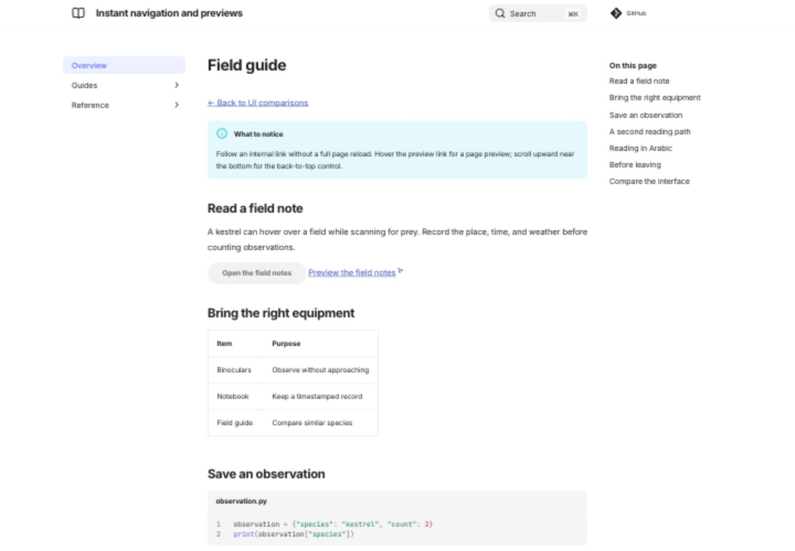{ loading=lazy }

??? example "Settings used in this comparison"

    ```toml
    features = ["navigation.instant", "navigation.instant.prefetch", "navigation.instant.progress", "navigation.instant.preview", "navigation.tracking", "navigation.top"]
    ```

## Dark color scheme

A fixed dark palette changes surfaces and code colors. Compare the same callout and code block in the light baseline.

[Open live dark color scheme demo](/zensical-examples/variants/dark/){ .md-button }

??? example "Screenshot: Dark color scheme"

    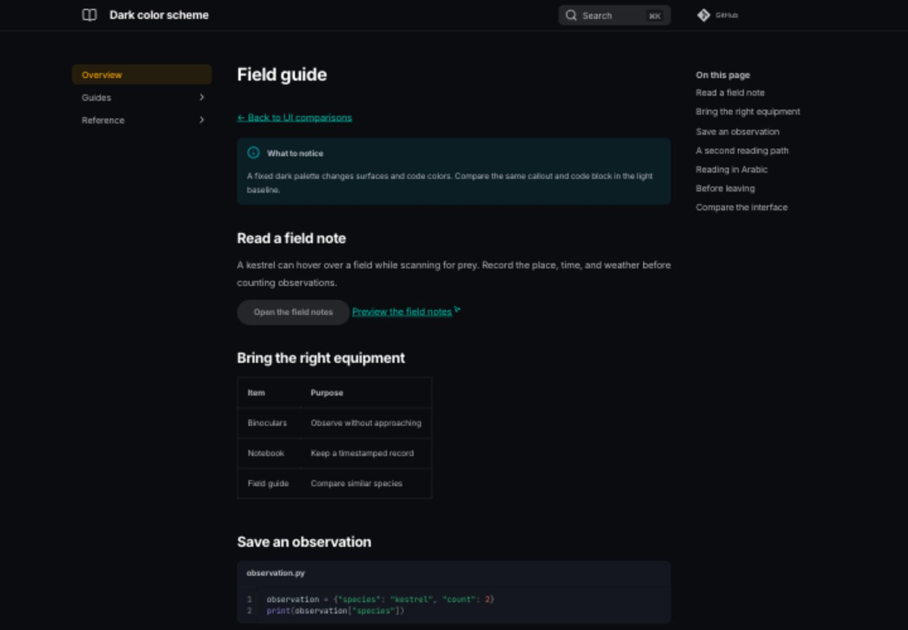{ loading=lazy }

??? example "Settings used in this comparison"

    ```toml
    features = []
    palette = { scheme = "slate", primary = "teal", accent = "amber" }
    ```

## Primary and accent colors

A teal primary color and orange accent change navigation and interactive emphasis. Hover a link to see the accent.

[Open live primary and accent colors demo](/zensical-examples/variants/colors/){ .md-button }

??? example "Screenshot: Primary and accent colors"

    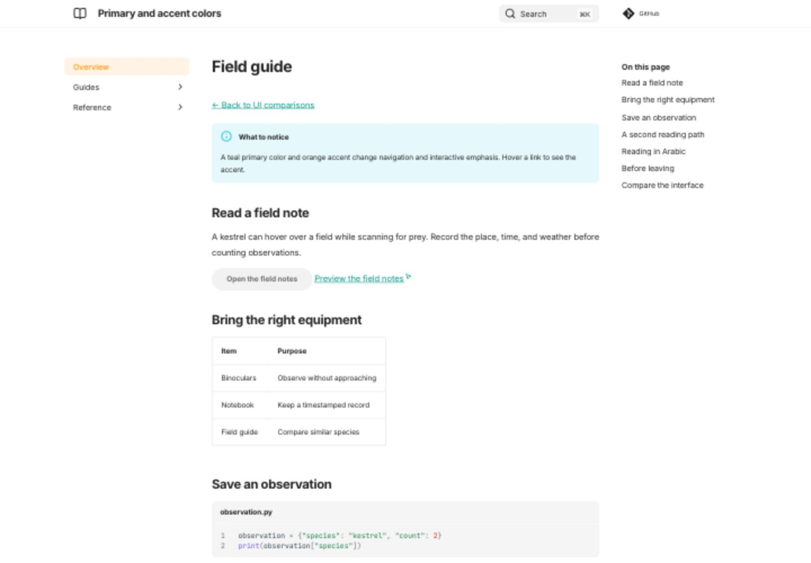{ loading=lazy }

??? example "Settings used in this comparison"

    ```toml
    features = []
    palette = { scheme = "default", primary = "teal", accent = "orange" }
    ```

## Alternative typography

Serif body text gives long prose a different texture; monospace source uses Fira Code. Font loading requires a network connection.

[Open live alternative typography demo](/zensical-examples/variants/fonts/){ .md-button }

??? example "Screenshot: Alternative typography"

    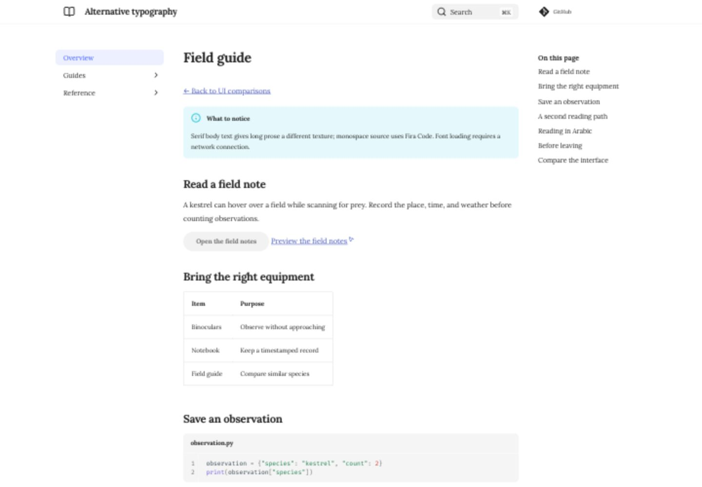{ loading=lazy }

??? example "Settings used in this comparison"

    ```toml
    features = []
    font = { text = "Lora", code = "Fira Code" }
    ```

## System fonts

The theme uses locally available system fonts without fetching Google Fonts. Compare text width and code with the typography variant.

[Open live system fonts demo](/zensical-examples/variants/system-fonts/){ .md-button }

??? example "Screenshot: System fonts"

    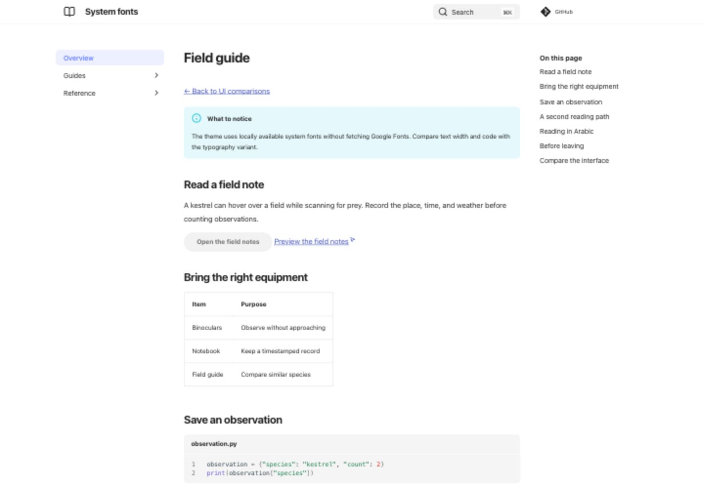{ loading=lazy }

??? example "Settings used in this comparison"

    ```toml
    features = []
    font = false
    ```

## Arabic and right-to-left layout

The navigation and interface run right to left. The Arabic sample shows text direction; English examples remain intentionally visible for comparison.

[Open live arabic and right-to-left layout demo](/zensical-examples/variants/rtl/){ .md-button }

??? example "Screenshot: Arabic and right-to-left layout"

    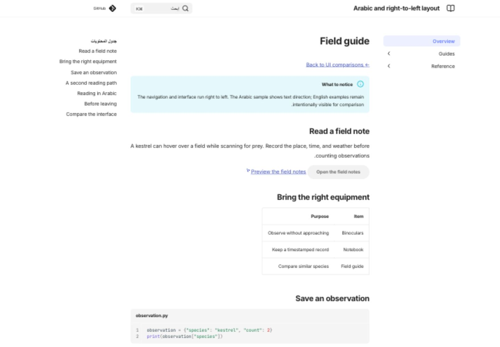{ loading=lazy }

??? example "Settings used in this comparison"

    ```toml
    features = []
    language = "ar"
    direction = "rtl"
    ```

## Autohiding header

Scroll down until the header leaves view, then scroll upward to reveal it. This creates more reading space.

[Open live autohiding header demo](/zensical-examples/variants/header/){ .md-button }

??? example "Screenshot: Autohiding header"

    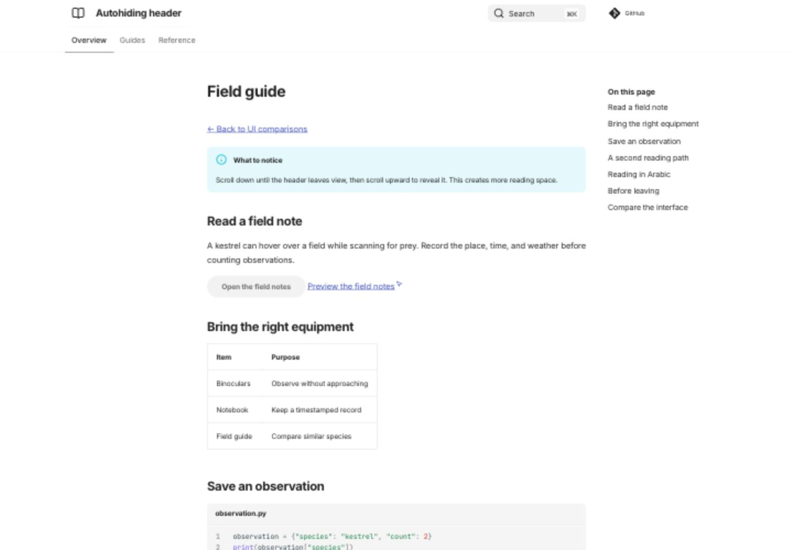{ loading=lazy }

??? example "Settings used in this comparison"

    ```toml
    features = ["header.autohide", "navigation.tabs"]
    ```

## Page and code actions

Use the source/view links near the title and the copy/select controls in the code block. The repository links point to the shared fixture generator.

[Open live page and code actions demo](/zensical-examples/variants/content-actions/){ .md-button }

??? example "Screenshot: Page and code actions"

    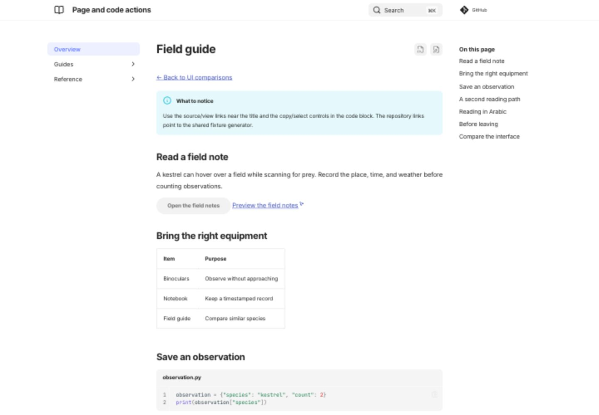{ loading=lazy }

??? example "Settings used in this comparison"

    ```toml
    features = ["content.action.edit", "content.action.view", "content.code.copy", "content.code.select", "content.code.annotate"]
    ```

## Search suggestions and highlighting

Search for kestrel. Follow a result to see matching text highlighted. Use the share control to preserve a search query in a URL.

[Open live search suggestions and highlighting demo](/zensical-examples/variants/search-ui/){ .md-button }

??? example "Screenshot: Search suggestions and highlighting"

    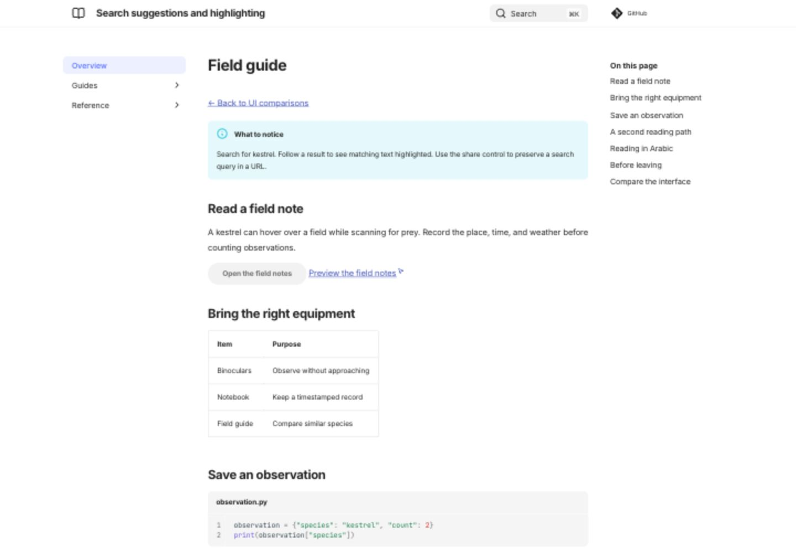{ loading=lazy }

??? example "Settings used in this comparison"

    ```toml
    features = ["search.suggest", "search.highlight", "search.share"]
    ```

## Screenshot comparisons

The [screenshot gallery](screenshots.md) compares actual desktop renders. Expand the screenshot beside any live demo above for its initial view.

## Choosing a layout

Use sections for a short manual whose structure should stay visible. Tabs suit several major audiences or product areas. Expanded navigation is useful when the entire tree fits comfortably on screen. Pruning helps large trees; it cannot be combined with expansion. An integrated contents list saves a sidebar but cannot be combined with section indexes.

[Official navigation guide](https://zensical.org/docs/setup/navigation/) · [Colors](https://zensical.org/docs/setup/colors/) · [Fonts](https://zensical.org/docs/setup/fonts/) · [Language](https://zensical.org/docs/setup/language/)
