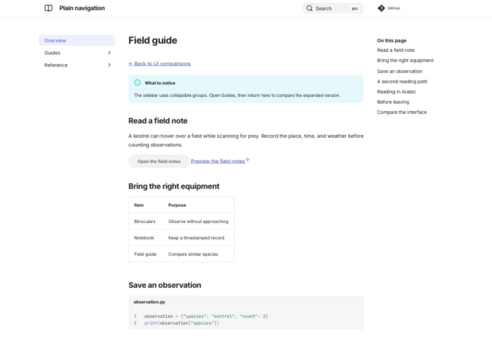
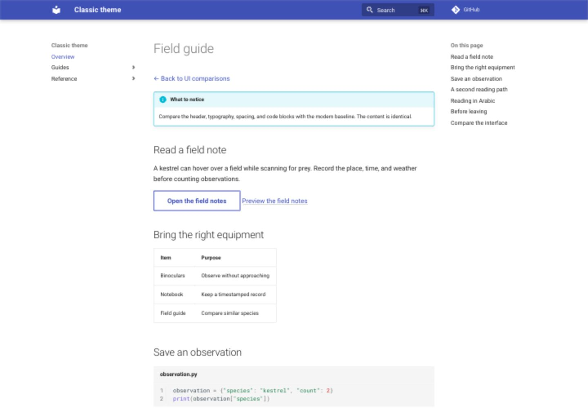
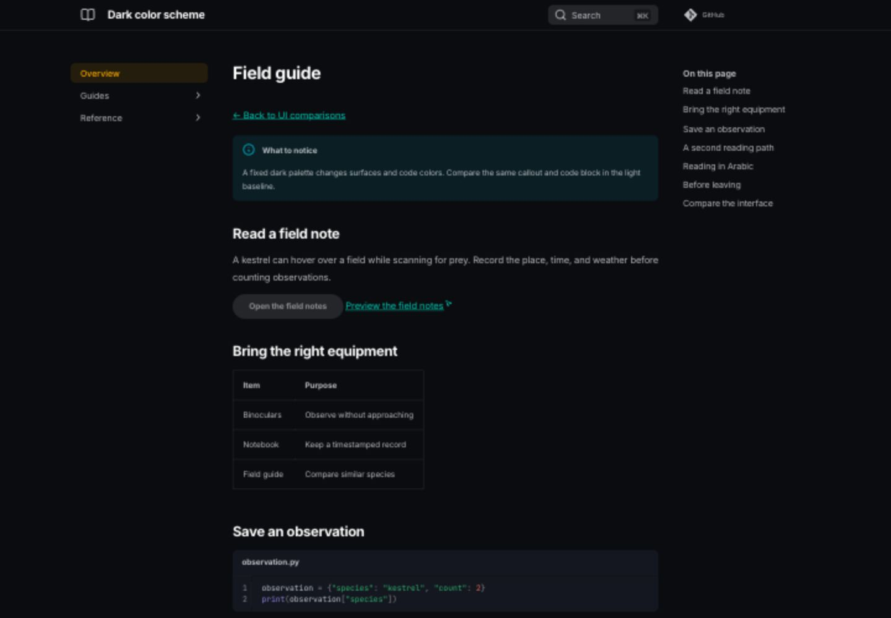
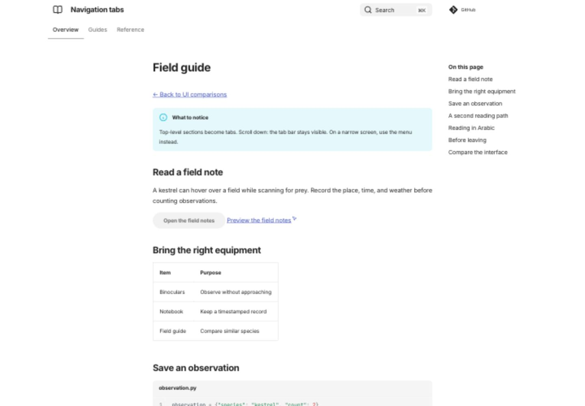
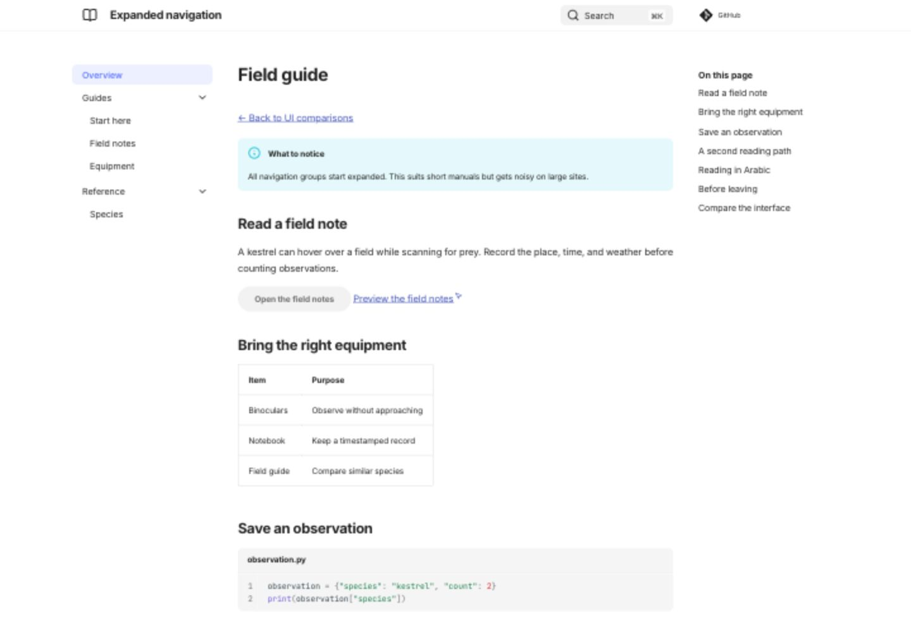
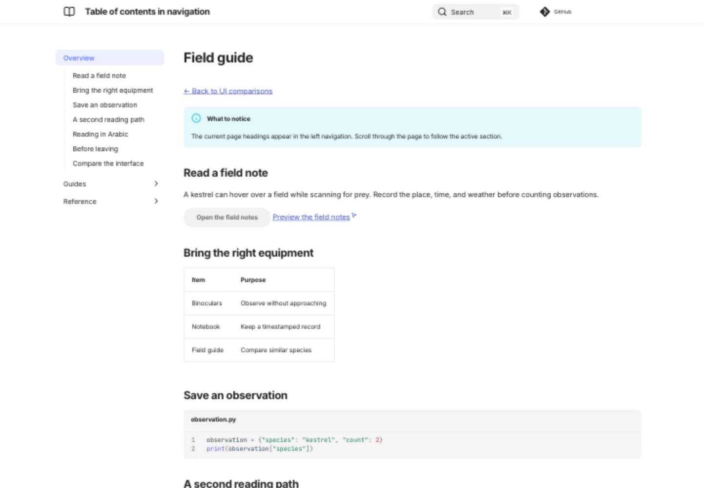

# Compare actual renders

These captures show the live Zensical variants at **1440 × 1000**, at the top of the page, on November 8, 2026. They use Zensical 0.1.0 and UI 0.0.41. Screenshots show appearance; use the live demos to test scrolling, search, and navigation.

## Modern and classic

=== "Modern"

    

    [Open modern](/zensical-examples/variants/baseline/)

=== "Classic"

    

    [Open classic](/zensical-examples/variants/classic/)

## Light and dark

=== "Light"

    

=== "Dark"

    

    [Open dark](/zensical-examples/variants/dark/)

## Different navigation structures

=== "Tabs"

    

=== "Expanded"

    

=== "Integrated contents"

    

[All live comparisons and their screenshots](index.md)
