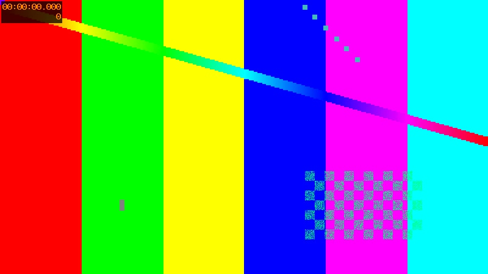

# optimize example

[← Return to the optimize explainer](/zensical-examples/plugins/optimize/)

The [JPEG fixture](photo.jpg) is processed at build time. Compare its built size with the source fixture to measure the result.

The second [JPEG fixture](second.jpg) is optimized too.

